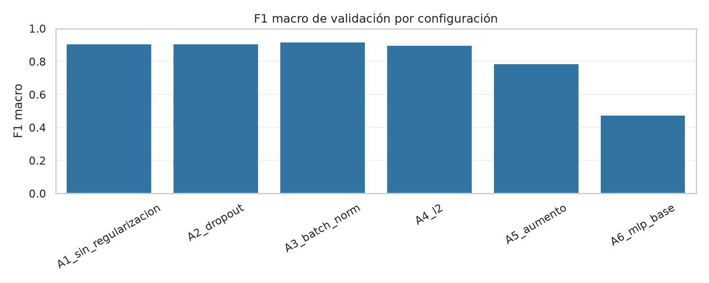
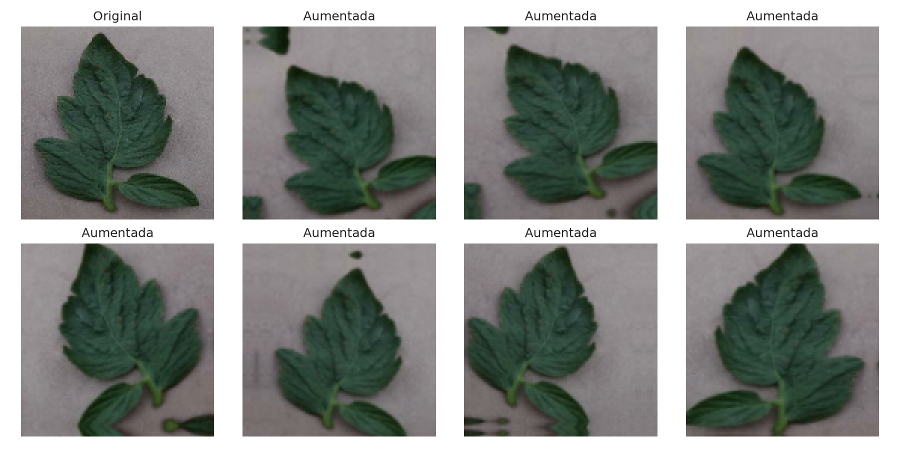
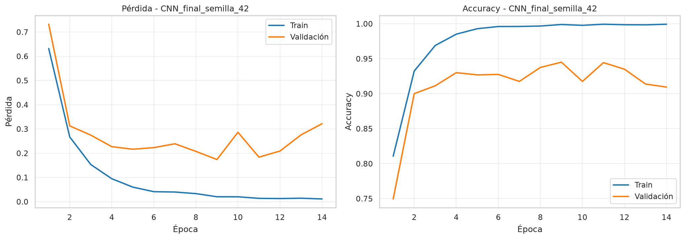
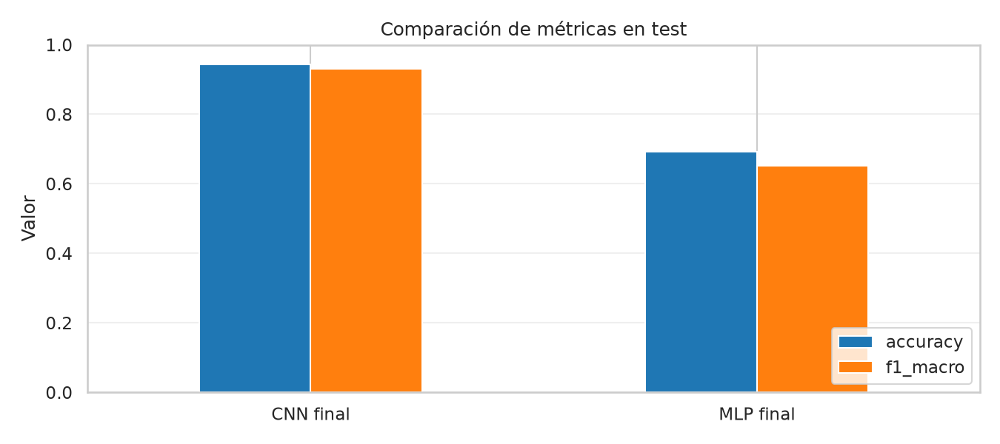

# Informe técnico EP3

## Pipeline integrado, regularización y comparación MLP vs CNN para patologías en tomate

**Asignatura:** TLY1102 Técnicas Avanzadas de Machine Learning I  
**Sección:** 001D  
**Integrantes:** Matías Gutiérrez, David Larenas, Victor Mena  
**Entrega:** Evaluación Parcial 3  
**Fecha:** Noviembre de 2026

---

## 1. Resumen ejecutivo

{{RESUMEN_EJECUTIVO}}

El trabajo se organiza en un pipeline de nueve etapas, dos arquitecturas comparables y una búsqueda de hiperparámetros con selección por F1 macro de validación. El conjunto de prueba se reserva para la evaluación final. La comparación incluye métricas de desempeño, generalización, costo computacional, auditoría de sesgos y explicabilidad.

## 2. Descripción del problema de negocio

El tomate es uno de los cultivos más relevantes de la agricultura intensiva y familiar. Las enfermedades foliares reducen el rendimiento y obligan a un diagnóstico oportuno, que en terreno depende de personal especializado. Una herramienta de apoyo visual puede priorizar casos y reducir el tiempo entre la captura de la imagen y la revisión técnica.

El problema de negocio no es reemplazar al agrónomo. Es construir un clasificador reproducible que distinga diez condiciones foliares del tomate con un desempeño suficiente para apoyar la priorización de casos. La decisión final sigue siendo humana, sobre todo cuando el modelo se equivoca entre enfermedades con síntomas parecidos.

El dataset disponible contiene imágenes de laboratorio, con una hoja centrada y un fondo uniforme. Esa condición facilita el aprendizaje, pero no representa una huerta real. El informe y la aplicación deben explicitar ese límite. Cualquier uso fuera del contexto académico requiere una validación en campo.

## 3. Objetivos

**Objetivo general.** Construir y comparar dos soluciones de aprendizaje profundo, una MLP y una CNN, para clasificar diez clases de patologías del tomate, usando un pipeline integrado, reproducible y auditable.

**Objetivos específicos.**

1. Reutilizar el split estratificado de la EP2 y mantener las mismas diez clases, el mismo orden y la misma resolución de entrada.
2. Implementar un pipeline de nueve etapas con funciones reutilizables, desde la carga hasta la auditoría.
3. Incorporar regularización con Dropout, Batch Normalization, L2, aumento de datos y parada temprana.
4. Optimizar hiperparámetros con experimentación controlada, primero un parámetro a la vez y luego una búsqueda aleatoria con presupuesto fijo.
5. Evaluar con accuracy, precision, recall, F1 macro, F1 ponderado, ROC-AUC, matrices de confusión y curvas de aprendizaje.
6. Auditar sesgos de entrada, de sistema y de aplicación, e identificar riesgos para el uso real.
7. Aplicar Grad-CAM a la CNN y LIME a la MLP para comparar la interpretabilidad de ambas arquitecturas.
8. Seleccionar un modelo final con evidencia experimental y justificar la decisión.

## 4. KPIs

| KPI | Definición | Meta |
|---|---|---|
| Accuracy | Proporción de aciertos sobre el total de imágenes de prueba | Reportar, no usar como único criterio |
| F1 macro | Promedio no ponderado del F1 por clase | Mayor o igual a 0,90 en la CNN final |
| F1 ponderado | F1 ponderado por el soporte de cada clase | Cercano al F1 macro, sin ocultar clases minoritarias |
| ROC-AUC | Capacidad de separación entre clases, promedio macro | Mayor o igual a 0,98 |
| Brecha train-test | Diferencia entre accuracy de entrenamiento y de prueba | Menor o igual a 0,10 |
| Tiempo de inferencia | Milisegundos por imagen en la GPU local | Menor o igual a 50 ms |
| Parámetros | Cantidad de parámetros entrenables | Reportar el costo de cada arquitectura |

El KPI principal es el F1 macro. El dataset está desbalanceado y la accuracy puede ocultar el desempeño en las clases minoritarias. El F1 ponderado se reporta como complemento, junto con el soporte de cada clase. La brecha train-test y el tiempo de inferencia permiten juzgar la generalización y el costo de uso.

## 5. Fuentes de datos

{{TABLA_DATOS}}

Usamos el subconjunto de tomate de PlantVillage, disponible en Kaggle como `emmarex/plantdisease`. Las imágenes originales son de 256 x 256 píxeles y el modelo las recibe a 128 x 128. El split es estratificado 80/10/10 con `random_state=42` y se guardó en `data/split.csv` para que todas las corridas usen exactamente las mismas imágenes.

La clase mayoritaria es `Tomato__Tomato_YellowLeaf__Curl_Virus` y la minoritaria es `Tomato__Tomato_mosaic_virus`. La razón entre ambas es cercana a 8,6 a 1. Esa diferencia es el primer foco de la auditoría.

## 6. Preparación y análisis exploratorio

Revisamos la cantidad de imágenes por clase y por partición, el tamaño y el modo de color, la existencia de archivos faltantes y la duplicación exacta. Todas las imágenes se pudieron leer, tienen tres canales y no se encontraron duplicados exactos. El split conserva las diez clases en train, validation y test.


La distribución se mantiene en las tres particiones por el split estratificado. La clase sana y la clase de virus del rizado amarillo concentran la mayor cantidad de imágenes. Las clases de mildiu y mosaico tienen menos ejemplos. El desbalance no se corrigió con sobremuestreo ni con pesos de clase, para no alterar la comparación con la EP2. El efecto se mide en la auditoría.


Las imágenes muestran una hoja centrada, iluminación controlada y fondo uniforme. Esa uniformidad explica por qué un modelo puede aprender la enfermedad y también por qué puede fallar en una foto de campo con fondo, sombra o varias hojas.

## 7. Metodología CRISP-DM

| Fase | Actividades | Entregable |
|---|---|---|
| Comprensión del negocio | Definir el problema, los objetivos y los KPIs | Este informe y la sección 1 del notebook |
| Comprensión de los datos | Revisar clases, tamaños, balance, duplicados y calidad | Tabla de datos y figuras del EDA |
| Preparación de los datos | Split estratificado, carga, redimensionado, normalización y aumento | `data/split.csv`, `cargar_datos`, `crear_dataset` |
| Modelado | MLP, CNN, regularización y búsqueda de hiperparámetros | `construir_modelo`, `optimizar_modelo` |
| Evaluación | Métricas, matrices, curvas, auditoría y XAI | `evaluar_metricas`, secciones 8 a 10 del notebook |
| Despliegue | Recomendación de uso y límites, sin puesta en producción | Modelo final y guía de uso |

No desplegamos el modelo. La fase de despliegue se limita a una recomendación documentada, porque el dataset es de laboratorio y no existe una validación externa. Presentar el modelo como un producto listo para campo sería una afirmación que los datos no sostienen.

## 8. Pipeline integrado

| Etapa | Función | Propósito |
|---|---|---|
| 1. Carga | `cargar_datos` | Leer el split, las clases y las rutas absolutas |
| 2. Análisis | `analizar_dataset` | Revisar balance, tamaños y muestras |
| 3. Preprocesamiento | `cargar_imagen`, `crear_dataset` | Decodificar, redimensionar, normalizar y crear lotes |
| 4. Construcción | `construir_modelo` | Armar la MLP o la CNN con regularización opcional |
| 5. Entrenamiento | `entrenar_modelo` | Entrenar con parada temprana y registrar el historial |
| 6. Regularización | `crear_aumento`, capas de Dropout, BatchNorm y L2 | Reducir el sobreajuste |
| 7. Evaluación | `evaluar_metricas`, `graficar_curvas` | Calcular métricas, matrices y curvas |
| 8. Auditoría | `prueba_estres`, análisis por clase | Medir sesgos y robustez |
| 9. Optimización | `optimizar_modelo` | Comparar configuraciones y elegir la mejor por validación |

El pipeline se implementa con funciones separadas y sin clases. Cada función recibe los datos, devuelve resultados y escribe sus artefactos en `models/` o `images/`. Esa separación permite reutilizar el código en la EP2 y en la EP3, y facilita la revisión por terceros.

## 9. Modelos MLP y CNN

| Modelo | Arquitectura | Regularización | Parámetros |
|---|---|---|---|
| MLP | Entrada 128 x 128 x 3, Flatten, Dense 512, 256 y 128, salida 10 | Dropout, BatchNorm, L2 y aumento según configuración | {{MLP_PARAMS}} |
| CNN | Tres bloques Conv2D de 32, 64 y 128 filtros, MaxPooling, Dense 128, salida 10 | Dropout, BatchNorm, L2 y aumento según configuración | {{CNN_PARAMS}} |

La MLP aplana la imagen y pierde la estructura espacial. La CNN comparte pesos en toda la imagen y conserva la noción de vecindad. Esa diferencia es la hipótesis principal de la comparación. La MLP se mantiene como línea base porque la EP2 la usó y porque permite medir cuánto aporta la convolución.

La CNN usa filtros de 3 x 3, activación ReLU, inicialización He y `padding='same'`. Cada bloque reduce la resolución con MaxPooling y aumenta la cantidad de filtros. La capa densa final tiene 128 neuronas y la salida es softmax. La configuración base usa Dropout de 0,2 en las capas convolucionales y de 0,3 en la capa densa.

## 10. Regularización y aumento de datos

{{ABLACION_TEXTO}}

{{TABLA_ABLACION}}



El aumento de datos aplica volteo horizontal, rotación de 0,08, zoom de 0,10, traslación de 0,08 y contraste de 0,10. No usamos volteo vertical porque una hoja invertida no es una condición real de captura. No usamos cambios de color agresivos porque el color es una señal diagnóstica y no queremos destruirla.



La parada temprana monitorea `val_loss` con paciencia 5 y restaura los mejores pesos. El Dropout se activa solo durante el entrenamiento. Batch Normalization se aplica antes de la activación. L2 se aplica a los kernels convolucionales y a las capas densas con un factor pequeño.

## 11. Optimización de hiperparámetros

{{SCREENING_TEXTO}}

{{TABLA_SCREENING}}


Descartamos GridSearchCV porque obliga a envolver el modelo de Keras y multiplica el costo por cada fold de validación cruzada. Descartamos la optimización bayesiana porque requiere una librería adicional y con ocho evaluaciones no compensa la complejidad. Usamos un screening univariado para conocer la dirección de cada hiperparámetro y luego un Random Search con presupuesto fijo.

{{BUSQUEDA_TEXTO}}

{{TABLA_BUSQUEDA}}


El espacio de búsqueda cubre la tasa de aprendizaje en escala logarítmica entre 1e-4 y 1e-3, el tamaño de lote entre 32 y 64, el Dropout convolucional entre 0,2 y 0,4, el Dropout denso entre 0,3 y 0,5, dos configuraciones de filtros y L2 en escala logarítmica entre 1e-5 y 1e-3. La selección se hace por F1 macro de validación. El test no se usa para elegir.

## 12. Resultados experimentales

{{RESULTADOS_TEXTO}}

{{TABLA_FINAL}}




La CNN final se entrena con la mejor configuración y tres semillas. La semilla 42 se guarda como modelo final. Las semillas 43 y 44 se usan para reportar la variabilidad. La MLP se entrena con su mejor configuración y las mismas tres semillas.

## 13. Auditoría de sesgos

{{AUDITORIA_TEXTO}}

{{TABLA_AUDITORIA}}


{{TABLA_ESTRES}}


La auditoría se organiza en tres niveles. El sesgo de entrada incluye el desbalance de clases, la baja representación de mildiu y mosaico y el origen único de laboratorio. El sesgo de sistema incluye el uso de accuracy como métrica única, la confusión entre Early blight y Late blight y la diferencia entre F1 macro y F1 ponderado. El sesgo de aplicación incluye el uso en campo, la diferencia entre una hoja aislada y una planta completa y el riesgo de falsos negativos en la clase sana.

Las medidas de mitigación propuestas son aumentar la representación de las clases minoritarias, validar con imágenes de campo, mantener una revisión humana de los casos de baja confianza, monitorear el desempeño por clase y reentrenar cuando cambie la población de imágenes. Ninguna de estas medidas se implementó en esta entrega. Quedan como trabajo futuro.

## 14. Explicabilidad

{{XAI_TEXTO}}


Grad-CAM muestra las regiones de la imagen que más influyen en la clase predicha. En la CNN, el mapa se calcula sobre la activación de la última capa convolucional y se superpone a la imagen original. LIME aproxima el modelo con perturbaciones locales y resalta las regiones que sostienen la predicción de la MLP.

Las dos técnicas no prueban causalidad. Sirven para revisar si el modelo mira la hoja o el fondo, si las confusiones tienen una explicación visual y si la MLP y la CNN usan señales distintas. Esa revisión es parte de la auditoría, no un reemplazo de las métricas.

## 15. Comparación MLP vs CNN

{{COMPARACION_TEXTO}}

{{TABLA_COMPARACION}}



| Criterio | MLP | CNN | Comentario |
|---|---|---|---|
| Desempeño | Línea base | Mejor F1 macro | La convolución aprovecha la estructura espacial |
| Generalización | Brecha moderada | Brecha controlada | La regularización reduce la brecha |
| Parámetros | Más parámetros | Menos parámetros | La CNN comparte pesos |
| Tiempo de entrenamiento | Menor | Mayor | La CNN es más costosa por época |
| Tiempo de inferencia | Menor | Mayor | Ambas son rápidas para una imagen |
| Interpretabilidad | LIME | Grad-CAM | La CNN tiene una explicación espacial más natural |
| Robustez | Menor | Mayor | La CNN resiste mejor cambios de brillo y contraste |

{{TABLA_DECISIONES}}

La recomendación es usar la CNN como modelo principal y mantener la MLP como línea base y alternativa liviana. La CNN no se recomienda como diagnóstico autónomo. Se recomienda como apoyo a la priorización de casos, con revisión humana y con un monitoreo del desempeño por clase.

## 16. Limitaciones y trabajo futuro

1. El dataset es de laboratorio. No hay imágenes de campo, con fondo, sombra, varias hojas o distintas cámaras.
2. El test es una partición interna del mismo dataset. No hay un conjunto externo de validación.
3. El desbalance se documenta, pero no se corrige con pesos de clase ni con remuestreo.
4. La comparación usa tres semillas. Es suficiente para reportar variabilidad, no para un estudio estadístico exhaustivo.
5. El modelo clasifica una hoja aislada. No detecta la hoja dentro de una planta ni segmenta la lesión.
6. No se calibraron las probabilidades. La confianza se usa como señal de revisión, no como probabilidad clínica.
7. No se hizo una validación con agrónomos. La utilidad real requiere una evaluación con usuarios.
8. No se implementó un despliegue. El release contiene los modelos y los artefactos, no un servicio.

El trabajo futuro incluye recolectar imágenes de campo, evaluar la calibración, probar pesos de clase y transferencia desde modelos preentrenados, medir el desempeño con agrónomos y construir una interfaz de revisión que muestre la predicción, la confianza y el mapa de Grad-CAM.

## 17. Conclusiones

{{CONCLUSIONES_TEXTO}}

El pipeline quedó documentado y reproducible. El split, las semillas, las configuraciones y las métricas están en el repositorio. Cualquier persona puede repetir la corrida y comparar sus resultados con los de este informe. Esa trazabilidad es el aporte principal del trabajo, más allá de la diferencia entre las dos arquitecturas.

## 18. Referencias

1. Hughes, D. y Salathé, M. (2015). An open access repository of images on plant health to enable the development of mobile disease diagnostics. arXiv:1511.08060.
2. Prince, S. J. D. (2023). Understanding Deep Learning. MIT Press.
3. Bishop, C. M. y Bishop, H. (2023). Deep Learning: Foundations and Concepts. Springer.
4. Goodfellow, I., Bengio, Y. y Courville, A. (2016). Deep Learning. MIT Press.
5. Selvaraju, R. R. et al. (2017). Grad-CAM: Visual Explanations from Deep Networks via Gradient-based Localization. ICCV.
6. Ribeiro, M. T., Singh, S. y Guestrin, C. (2016). Why Should I Trust You? Explaining the Predictions of Any Classifier. KDD.
7. Chollet, F. (2021). Deep Learning with Python. Manning.
8. Wirth, R. y Hipp, J. (2000). CRISP-DM: Towards a Standard Process Model for Data Mining. Proceedings of the 4th International Conference on the Practical Application of Knowledge Discovery and Data Mining.

## 19. Anexos

### A. Estructura del repositorio

```
tly1102-tomate/
  README.md
  INFORME_TECNICO.md
  DEFENSA_EP3.md
  requirements.txt
  LICENSE
  data/
    README.md
    split.csv
    class_names.json
  notebooks/
    EP3_Gutierrez_Larenas_Mena.ipynb
  models/
    README.md
    experimentos.csv
    metricas_finales.json
    comparacion_final.csv
    historial/
    reportes/
  images/
  docs/
    presentacion.md
  legacy/
    EP2_Gutierrez_Larenas_Mena.ipynb
    README_EP2.md
    images/
    models/
```

### B. Reproducibilidad

La corrida usa `SEED=42`, el split de `data/split.csv`, imágenes de 128 x 128 y un máximo de 40 épocas con parada temprana. La búsqueda de hiperparámetros se ejecuta en el notebook y los resultados se guardan en `models/experimentos.csv`. Los modelos finales se publican en el release `v2.0` y no se versionan en git.

### C. Enlaces

- Repositorio: https://github.com/mtgutierrezh/tly1102-tomate
- Release: https://github.com/mtgutierrezh/tly1102-tomate/releases/tag/v2.0
- Notebook: `notebooks/EP3_Gutierrez_Larenas_Mena.ipynb`
- Defensa: `DEFENSA_EP3.md`
- Presentación: `docs/presentacion.md`
